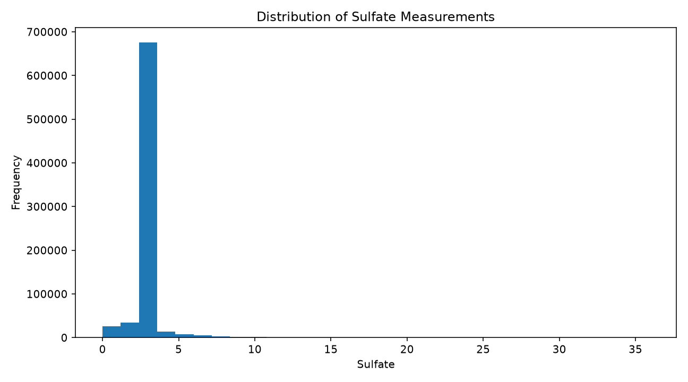
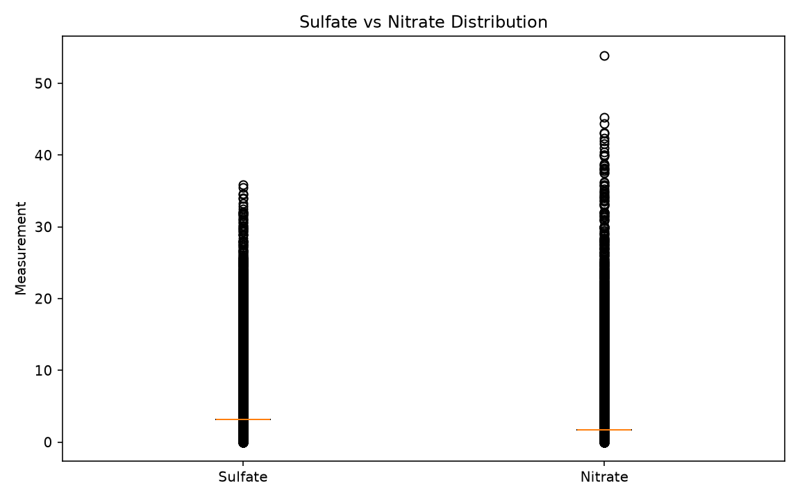
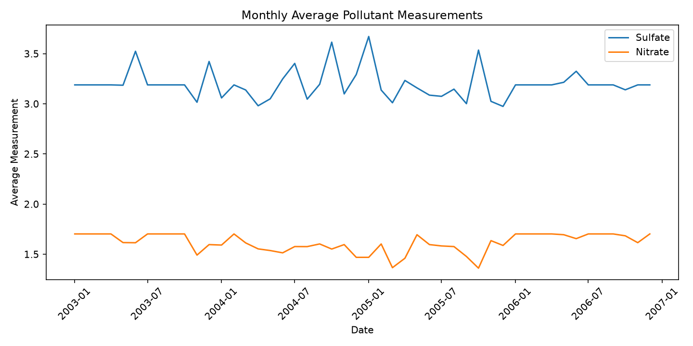
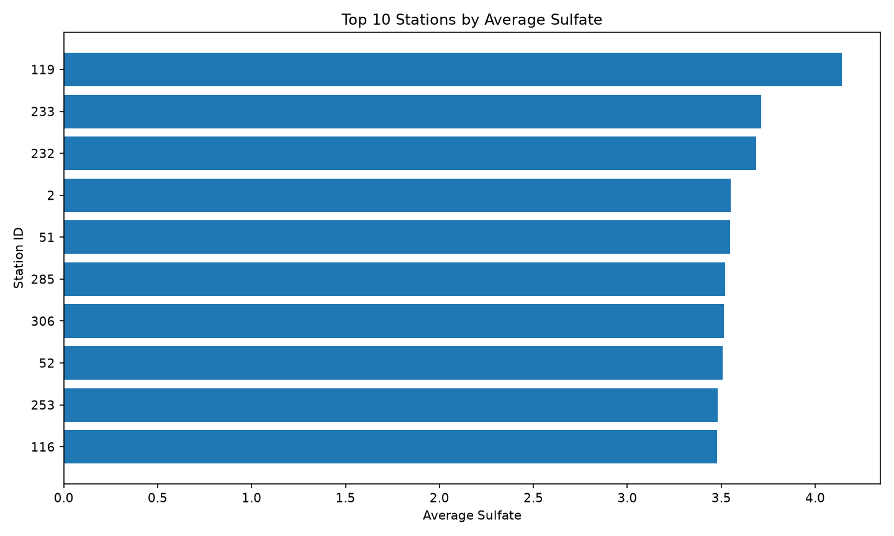

# Air Quality Data Analysis & Processing Pipeline

### Python | Pandas | NumPy | Matplotlib

## Project Overview

This project demonstrates an end-to-end data analysis workflow using Python. It processes air quality measurements collected across multiple CSV files, performs data cleaning, explores pollutant measurements, and generates visualizations.

## Project Objectives

- Consolidate 332 CSV files into one dataset.
- Identify and handle missing values.
- Remove duplicate records.
- Analyze sulfate and nitrate measurements.
- Compare measurements across monitoring stations.
- Visualize pollutant distributions and monthly trends.
- Export cleaned datasets and analysis results.

## Technologies Used

- **Python** — Data processing and analysis
- **Pandas** — Data cleaning, merging, and aggregation
- **NumPy** — Numerical operations
- **Matplotlib** — Data visualization
- **Spyder IDE** — Development environment

## Data Analysis Workflow

1. **Data Integration:** Combine 332 individual CSV files into one dataset.
2. **Data Cleaning:** Handle missing pollutant values using mean imputation and remove duplicate records.
3. **Exploratory Data Analysis:** Calculate descriptive statistics and compare average measurements by station.
4. **Data Visualization:** Generate histograms, boxplots, monthly trend charts, and station comparisons.
5. **Results Export:** Save cleaned datasets, aggregated summaries, charts, and a text report.
   

## Visualizations

### Sulfate Distribution

### Pollutant Comparison

### Monthly Pollutant Trends

### Top 10 Monitoring Stations

## Running the Project

1. Install Python and the dependencies listed in `requirements.txt`.
2. Download or prepare the source CSV files.
3. Update the dataset paths in the Python script.
4. Run `Data_Analytics_Project_Abdulaziz.py`.
5. Review the generated datasets, charts, and summary report.

## Future Improvements

- Build an interactive Power BI dashboard.
- Automate data validation.
- Compare pollutant measurements across years.
- Improve handling of outliers and missing data.

## Author

Abdulaziz Islam

Software Engineering Student | Python | Data Analytics
